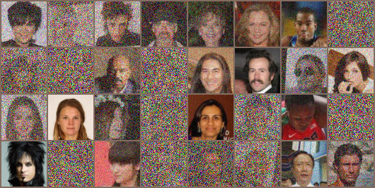
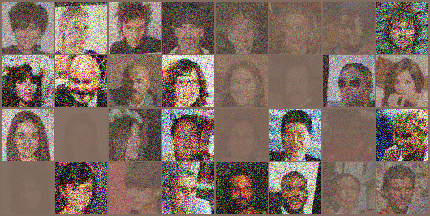
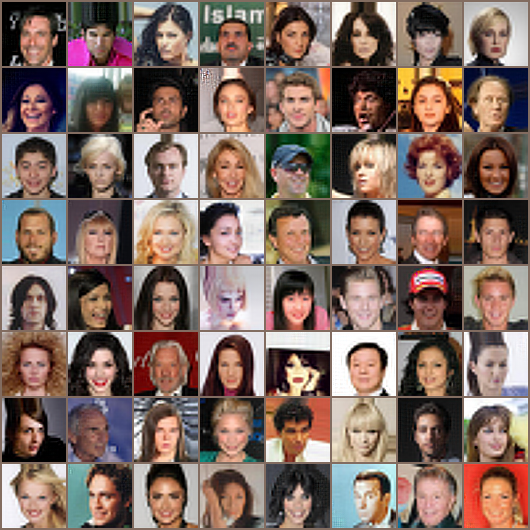
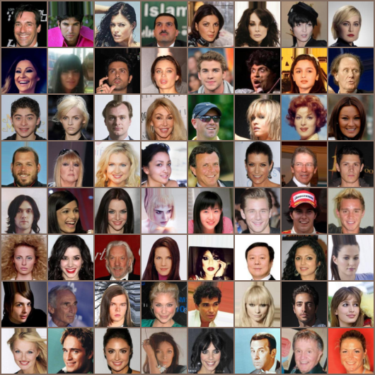

# Conditional Flow Matching

Code for flow matching on CelebA faces: generating faces from noise, and super-resolving blurry faces, by learning the velocity field of an ODE.

---

## Theory

Lecture notes for this topic are coming soon on https://parag1604.github.io/notes

In short: a continuous normalizing flow transports a simple distribution to the data with an ODE $dx/dt = v_\theta(x, t)$. Flow matching trains $v_\theta$ by plain regression, without simulating the ODE during training. Take a data image $x_0$ and a source image $x_1$, join them by the straight line $x_t = (1 - t)\,x_0 + t\,x_1$, and regress the velocity of that line:

$$
\mathcal{L}(\theta) = \mathbb{E}_{t \sim U(0,1),\, x_0,\, x_1} \left\| v_\theta(x_t, t) - (x_1 - x_0) \right\|^2 .
$$

The minimiser is the velocity field that carries the whole source distribution to the data distribution (conditional flow matching, Lipman et al., 2023; with straight lines this is also known as rectified flow, Liu et al., 2023). Sampling integrates the ODE from $t = 1$ back to $t = 0$. Here $t = 0$ is data and $t = 1$ is the source, as in diffusion models.

## Python Environment Setup

Use python >= 3.10 and install the requirements:

```bash
pip install -r requirements.txt
```

- PyTorch - the UNet, automatic differentiation and training (install the hardware accelerated build; the code picks CUDA, then Apple MPS, then CPU. The full model has about 62M parameters, so a GPU is needed for real training)
- Torchvision - image loading, transforms and saving image grids
- tqdm - progress bar when recomputing the dataset statistics

## Data

CelebA (aligned and cropped faces) from the official page: https://mmlab.ie.cuhk.edu.hk/projects/CelebA.html (download `img_align_celeba.zip`, the "Align&Cropped Images", via the links on that page). Unzip it so that the images sit one folder below `./data/celeba`, as torchvision's `ImageFolder` expects:

```
data/celeba/
    img_align_celeba/
        000001.jpg
        000002.jpg
        ...
```

Use `--data-dir` for another location. Images are resized and centre-cropped to 64x64 and normalised with the per-channel CelebA statistics in `dataloader.py`; recompute them with `python dataloader.py --data-dir ./data/celeba`.

## Code layout

- `dataloader.py` - CelebA loading and image saving
- `model.py` - a simplified time-conditioned UNet (sinusoidal time embedding, 4 down and 4 up blocks with skip connections); `python model.py` prints its size
- `common.py` - command-line options, the flow-matching loss and the Euler ODE sampler, shared by both versions

## Running

Both scripts accept `--epochs`, `--batch-size`, `--lr`, `--data-dir`, `--out-dir` (default `./results`), `--sample-steps` (Euler steps, default 50), `--target`, `--time-scale`, `--base` (UNet width; 64 is the original model), `--max-batches` (stop each epoch early), `--checkpoint` and `--sample-only`. Weights are saved to `models/`.

Quick check that everything runs (small UNet, two batches):

```bash
python version0.py --epochs 1 --max-batches 2 --batch-size 4 --base 8 --sample-steps 3 --num-workers 0
```

### 0. Flow matching from noise to faces

```bash
python version0.py --data-dir ./data/celeba --epochs 100
```

The source is Gaussian noise, $x_1 \sim \mathcal{N}(0, I)$, independent of the face $x_0$. After every epoch the script integrates the ODE from the same 64 noise images and saves `results/samples_<epoch>.png`. For the first batch it also saves what the network is trained on: the inputs $x_t$ (faces mixed with noise at random times $t$) and the regression targets. With `--target residual` the target is $x_t - x_0$ instead of $x_1 - x_0$. Example inputs and targets for that setting (left: $x_t$, right: targets):

$x_t$             |  target $x_t - x_0$
:-------------------------:|:-------------------------:
  |  

### 1. Flow matching for super-resolution

```bash
python version1.py --data-dir ./data/celeba --epochs 30
python version1.py --sample-only --checkpoint models/version1_29.pt --sample-steps 1
```

Same loss and the same straight-line paths, but the source is now a degraded copy of the same face, $x_1 = \mathrm{up}(\mathrm{down}(x_0))$ (64 to 24 to 64 pixels, bicubic), so the flow learns to turn blurry faces into sharp ones. Because every blurry image is paired with one sharp image, the learned paths are close to straight and one Euler step, $\hat{x}_0 = x_1 - v_\theta(x_1, 1)$, already works. The script saves `results/x_0.png` (ground truth), `results/x_1.png` (input) and `results/x_0_pred.png` (output) for a fixed batch. Result of a model trained for 30 epochs with `--target residual --time-scale 1`, sampled in one step:

Input $x_1$ (24 px, upsampled)             |  Output $\hat{x}_0$  |  Ground truth $x_0$
:-------------------------:|:-------------------------:|:-------------------------:
  |    |  

### Things to try

The original experiments compared these settings (four trained models):

| Target | Time fed to the network |
|---|---|
| `--target residual` ($x_t - x_0$) | `--time-scale 2000` |
| `--target velocity` ($x_1 - x_0$) | `--time-scale 2000` |
| `--target residual` | `--time-scale 1` |
| `--target velocity` | `--time-scale 1` |

The two targets carry the same information, since $x_t - x_0 = t\,(x_1 - x_0)$: the residual gives $\hat{x}_0 = x_t - \text{prediction}$ at any $t$, and the sampler converts it to a velocity by dividing by $t$. The time scale matters because the sinusoidal embedding mostly uses low frequencies for $t \in [0, 1]$; scaling $t$ up lets the network tell nearby times apart. Also compare `--sample-steps 1` with 10 or 50 in both versions: many steps are needed when starting from noise, few when starting from a blurry face.

The images in `static/` come from the original (pre-tutorial) version of this code.
