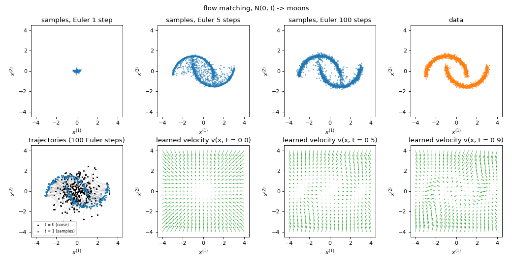
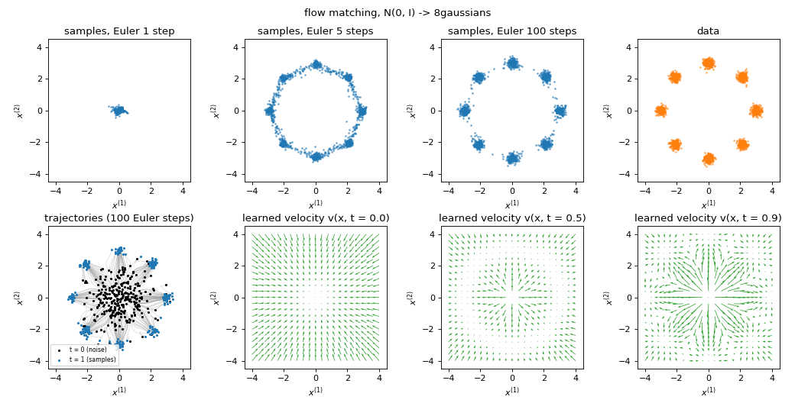
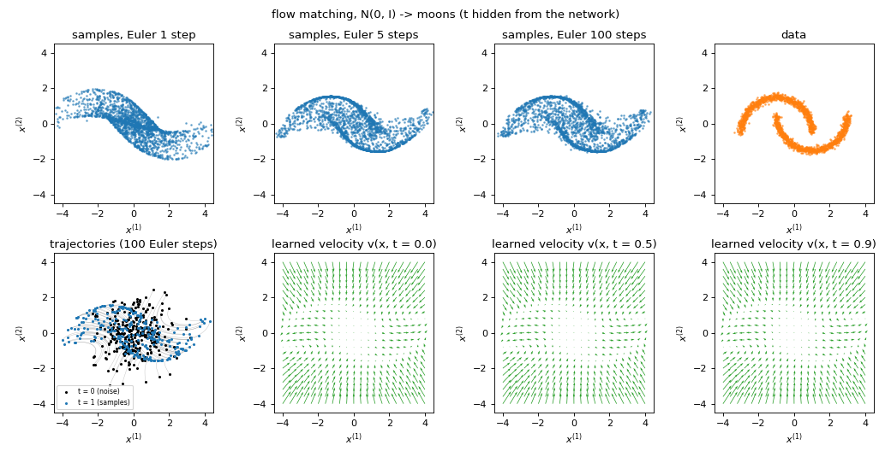
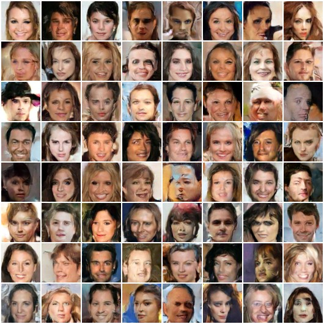
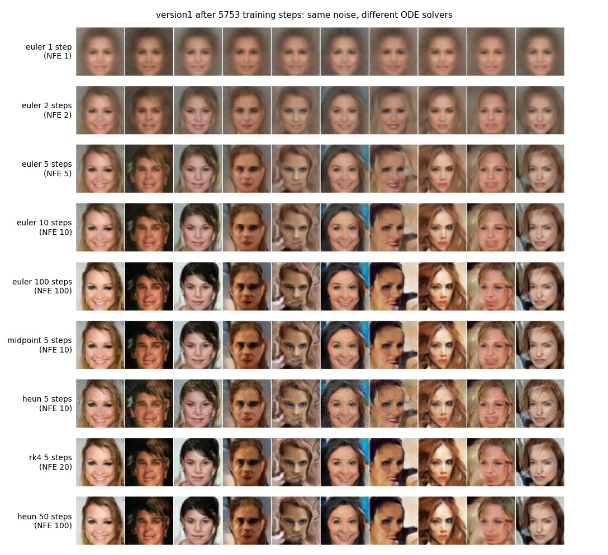
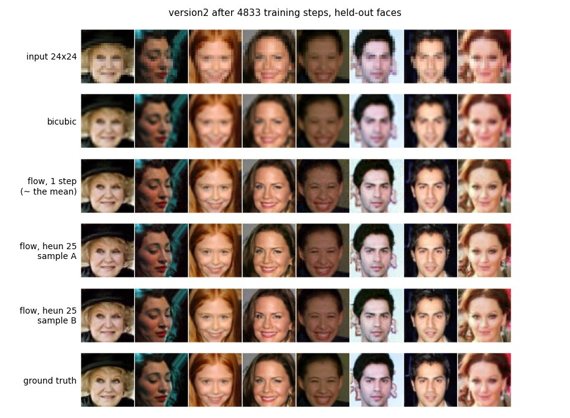
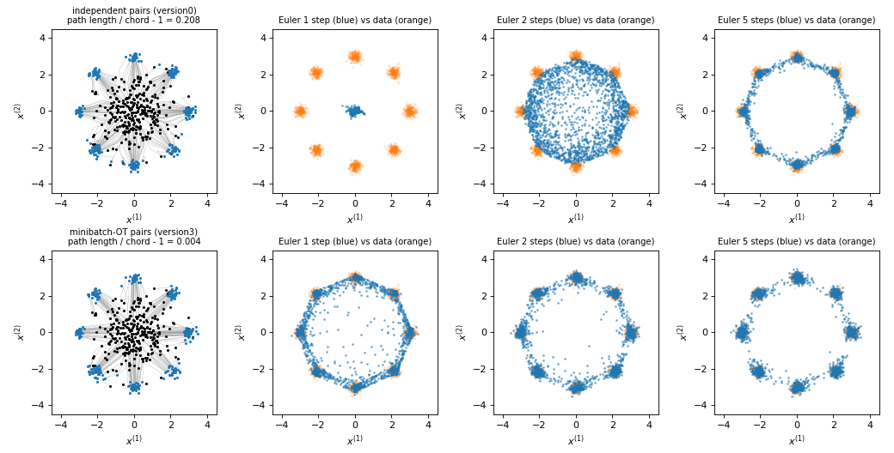
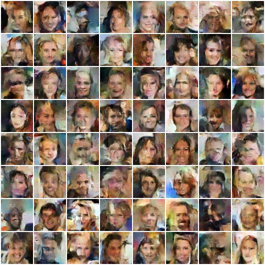

# Conditional Flow Matching

Flow matching from scratch: first on 2-D toy data, then generating 64x64 CelebA faces from noise, then super-resolving 24x24 faces to 64x64 with a conditional flow.

---

## Theory

Please note that the theory corresponding to the codes is hosted on this [page](https://parag1604.github.io/notes/Machine-Learning/Flow-Matching) (Flow Matching: conditional flow matching, rectified flow, minibatch-OT couplings, and the link to diffusion).

In short: a continuous normalizing flow transports a simple distribution to the data with an ODE $dx/dt = v_\theta(x, t)$. Flow matching trains $v_\theta$ by plain regression, without simulating the ODE during training. Take a noise sample $x_0 \sim \mathcal{N}(0, I)$ and a data sample $x_1$, join them by the straight line $x_t = (1 - t)\,x_0 + t\,x_1$, and regress the velocity of that line:

$$
\mathcal{L}(\theta) = \mathbb{E}_{t \sim U(0,1),\, x_0,\, x_1} \left\| v_\theta(x_t, t) - (x_1 - x_0) \right\|^2 .
$$

The minimiser is the marginal velocity field $v^*(x, t) = \mathbb{E}[x_1 - x_0 \mid x_t = x]$, whose ODE carries the noise distribution to the data distribution (conditional flow matching, Lipman et al., 2023; with straight lines this is also rectified flow, Liu et al., 2023). Sampling draws $x_0 \sim \mathcal{N}(0, I)$ and integrates the ODE from $t = 0$ to $t = 1$.

**Time convention used everywhere in this repo:** $t = 0$ is noise, $t = 1$ is data, and the target is $x_1 - x_0$ (data minus noise). The earlier version of this repo used the reverse convention ($t = 0$ data); both are fine as long as training and sampling agree.

## Python Environment Setup

Use python >= 3.10 and install the requirements:

```bash
pip install -r requirements.txt
```

- PyTorch and Torchvision: the networks, training, image loading (install the hardware-accelerated build; the code picks CUDA, then Apple MPS, then CPU)
- NumPy, Matplotlib, scikit-learn, SciPy: the 2-D toy versions and the figures (SciPy's `linear_sum_assignment` for version3)
- Pillow: reading the jpgs and writing the sample grids

## Data

Versions 0 and 3 generate their own 2-D data. Versions 1 and 2 use CelebA (aligned and cropped faces) from the official page: https://mmlab.ie.cuhk.edu.hk/projects/CelebA.html (download `img_align_celeba.zip`, the "Align&Cropped Images"). Unzip it anywhere and pass the folder of jpgs with `--data-dir`:

```
img_align_celeba/
    000001.jpg
    000002.jpg
    ...
```

`celeba.py` reads a flat folder of images (no class sub-folders needed), crops the central 140x140 face, resizes to 64x64, flips at random and scales pixels to $[-1, 1]$. With the full 202,599 images it uses the official partition: training on images 1 to 162,770, held-out figures and numbers on the test images (182,638 onwards). The data are never committed to this repo.

## Code layout

- `flows.py`: the flow-matching loss, the fixed-step ODE solvers (Euler, midpoint, Heun, RK4) and the EMA of the weights. Shared by every version.
- `unet.py`: a compact DDPM-style U-Net (16M parameters by default) with a proper time embedding; `python unet.py` prints its size.
- `celeba.py`: the flat-folder CelebA dataset and grid saving.
- `make_figures.py`: the figures and numbers below, from trained checkpoints.

## Running

### 0. Flow matching in 2-D

```bash
python version0.py --data moons
python version0.py --data 8gaussians
python version0.py --data moons --ignore-time
```

The whole method on a toy problem (an MLP, 10,000 iterations, well under a minute on a laptop CPU). Top row: samples after 1, 5 and 100 Euler steps, and the data. Bottom row: trajectories from noise to data, and the learned velocity field at three times.





Two things to notice, both of which matter for the image versions:

1. **One Euler step returns the mean of the data.** The network learns $v^*(x, t) = \mathbb{E}[x_1 - x_0 \mid x_t = x]$. At $t = 0$, $x_t = x_0$ is pure noise and tells us nothing about $x_1$, so $v^*(x_0, 0) = \mathbb{E}[x_1] - x_0$ and a single step $x_0 + v^*(x_0, 0)$ lands exactly on $\mathbb{E}[x_1]$, for every starting point. Only by taking several steps, and re-evaluating the field at later times where $x_t$ already carries information about $x_1$, do the samples spread out over the data.
2. **The field must depend on $t$.** `--ignore-time` hides $t$ from the network. The best it can do is a time-averaged field, and the samples smear into a blurry band around the data instead of two sharp moons:



### 1. Generating faces from noise

```bash
python version1.py --data-dir /path/to/img_align_celeba --minutes 44
python version1.py --sample-only --checkpoint checkpoints/version1.pt --method midpoint --steps 25
```

The same loss and solvers with a U-Net in place of the MLP, an EMA of the weights (decay 0.9995) for sampling, Adam at $2\times10^{-4}$ with 1,000 warm-up steps, gradient clipping and bf16 mixed precision on CUDA. `--minutes` caps the training time and `--resume` continues from `--checkpoint`. Every `--sample-every` steps it saves a grid of samples from fixed noise to `results/version1/`.

Samples (EMA weights, Heun with 50 steps) after 5,753 steps of batch 64 (44 minutes on an NVIDIA GB10 that was shared with other jobs; about 2.3 passes over the training set):



These are clearly faces and clearly different from each other, although at this short training many have asymmetric or smeared features; longer training (and a wider U-Net, `--ch 64`) improves them. The same ten noise images integrated with different solvers and step counts:



- **Euler with 1 step gives the mean face for every noise sample**, exactly as in the 2-D toy. Measured on 512 samples, the per-pixel standard deviation across samples is 0.079 for one Euler step against 0.478 for real held-out faces (ratio 0.16), and the average one-step output differs from the mean real face by only 0.038 per pixel (on the $[-1, 1]$ scale). With Heun and 50 steps the ratio is 0.93: the samples are about as varied as real faces.
- Euler needs about 10 steps for clean faces; midpoint and RK4 with 5 steps (10 and 20 network evaluations) look close to the 100-step result.
- **Heun with 5 steps leaves visible noise**, although it uses as many network evaluations as midpoint with 5 steps. Against a 100-step midpoint reference on 128 samples, Heun-5 has RMSE 0.23 and three times the high-frequency energy (mean absolute Laplacian 0.39 against 0.14), while midpoint-5 has RMSE 0.11 and no extra noise. Restricting Heun's evaluations to $t \le 0.9$ does not remove the noise, so it is not caused by evaluating the network at the data end $t = 1$; we have not pinned the cause down. With 50 steps Heun is fine. In practice: prefer midpoint (or RK4) for few-step sampling.

### 2. Super-resolution (24x24 to 64x64)

```bash
python version2.py --data-dir /path/to/img_align_celeba --minutes 44
python version2.py --sample-only --checkpoint checkpoints/version2.pt --method midpoint --steps 25
```

A conditional flow: still from noise to faces with the same loss, but the network also sees the low-resolution face, $v_\theta(x_t, t \mid y)$, with $y$ the 24x24 face upsampled back to 64x64 (bicubic) and concatenated to the input as three extra channels.

Held-out test faces after 4,833 steps of batch 64 (44 minutes on the shared GB10). Rows: the 24x24 input, bicubic upsampling, the flow with one Euler step, two samples from different noise (Heun, 25 steps), and the ground truth:



On 512 held-out faces:

| | PSNR to ground truth (dB) | PSNR of the output, downsampled to 24x24, to the input (dB) | high-frequency energy (mean abs. Laplacian) |
|---|---|---|---|
| ground truth | | | 0.140 |
| bicubic | 27.78 | 37.67 | 0.051 |
| flow, Euler 1 step | 28.46 | 37.09 | 0.169 |
| flow, Heun 25 steps | 28.11 | 40.64 | 0.160 |

- The flow's outputs are sharp (high-frequency energy close to the real faces, three times bicubic's) and consistent with the input: downsampled again, they match the 24x24 input better than bicubic upsampling does.
- PSNR barely moves (+0.3 to +0.7 dB over bicubic). That is expected: PSNR rewards the average of all plausible answers, and a sampler that invents one plausible set of details is penalised for every detail that differs from the truth. The one-step output, which in theory is the conditional mean $\mathbb{E}[x_1 \mid y]$, has the best PSNR, as it should; with this model it is also slightly noisy rather than blurry.
- Samples A and B differ only in fine details (hair strands, skin texture): at 24x24 the input already fixes most of a 64x64 face, so there is little left to be uncertain about. Sharpness slightly above the ground truth (0.160 against 0.140) means some of the invented texture is noise-like; longer training would reduce it.

### 3. Minibatch optimal-transport pairs (2-D)

```bash
python version3.py --data 8gaussians
```

Version0 pairs noise and data samples at random, so the straight training lines cross each other, the network learns their average at each crossing and the learned trajectories bend. Version3 re-pairs each minibatch by solving the assignment problem that minimises the total squared distance (Tong et al., 2024; Pooladian et al., 2023). The loss and the sampler are unchanged. The learned paths become almost straight (path length / straight-line distance minus 1 drops from 0.208 to 0.004), so a single Euler step already lands on the data instead of the mean:



In 12,288 dimensions with batches of 64 the OT pairing helps much less, so the image versions keep independent pairs.

## What was wrong with the earlier code

The previous version of this repo produced blurry faces that mostly looked like the average face. Reading the code and re-running it on the same GPU, these were the problems (the loss, the target $x_1 - x_0$, the time convention and the direction of integration were consistent, and were not the cause):

1. **Few-step sampling returns the mean, by construction.** The old super-resolution script recommended `--sample-steps 1`, i.e. $\hat x = x_{\text{blurry}} - v(x_{\text{blurry}}, 1)$. The regression target from a blurry face is the *average* of all sharp faces that blur to it, so one step returns that average: a blurry face, the posterior mean, not a sharp sample. The same happens when generating from noise with one or two steps (see the solver figure above: one Euler step gives the mean face for every noise sample). Sampling needs enough steps, and super-resolution needs a source with randomness in it (version2 starts from noise and conditions on the low-res image instead of starting from the blurry image).
2. **Weak time conditioning.** The default `--time-scale 1` fed $t \in [0, 1]$ straight into a 32-dimensional sinusoidal embedding whose frequencies run from 1 down to $10^{-4}$, so only about three of the 32 features changed noticeably over the whole interval (the embeddings of $t = 0$ and $t = 1$ differ by 1.15, against a norm of 4), and each block saw $t$ through one linear layer added once. A velocity field that cannot tell the times apart can only learn a time-averaged field, which collapses towards the middle of the data (version0 `--ignore-time` shows this in 2-D). Measured on trained models, changing $t$ from 0.2 to 0.8 at a fixed input changed the old network's output by 29%, and the new network's by 59%. The new U-Net multiplies $t$ by 1000 before the embedding and uses it to scale and shift the features of every residual block.
3. **BatchNorm in the velocity network.** The output for one image depended on the other images in the batch during training, and on running statistics gathered over a mix of times $t$ at sampling. The new U-Net uses GroupNorm.
4. **Architecture details:** no skip connection at the full 64x64 resolution (the first skip was at 32x32, so all fine detail had to be re-created from a 2x upsampling), transposed convolutions (checkerboard artefacts) and a 62M-parameter model that was slow to train. The new U-Net has skips at every resolution, nearest-neighbour upsampling, self-attention at 16x16 and 8x8, and 16M parameters.
5. **No EMA of the weights** and no gradient clipping; sampling used the raw, noisy weights.
6. Smaller things: the dataset class needed an `ImageFolder` sub-folder (the server copy of CelebA is a flat folder), and the images were resized before cropping, so a lot of each 64x64 image was background.

Re-running the old code unchanged (default settings: velocity target, `--time-scale 1`, batch 32) for 4,000 steps (about 36 minutes) on the same GPU gave smeared, incoherent faces (Euler with 50 steps, below); the per-pixel standard deviation across its samples was 0.77 of the real one, against 0.93 for version1 after a similar 44 minutes. Already after 2,000 steps (about 15 minutes) version1's samples were cleaner than these.



In this re-run the old unconditional model did not collapse completely to one mean face at 50 steps; the strongest "regression to the mean" comes from points 1 and 2 (one-step sampling, and a field that barely depends on $t$).


## What was run

- versions 0 and 3: on a MacBook CPU (under a minute per model), with the commands above; the figures in `static/` are their direct output.
- versions 1 and 2: on an NVIDIA GB10 (shared with other jobs at the time), PyTorch 2.9, bf16, batch 64, `--minutes 44` each, on the full CelebA training split (162,770 images). Version1 reached 5,753 steps, version2 4,833. Figures and numbers: `python make_figures.py --data-dir ... --v1 checkpoints/version1.pt --v2 checkpoints/version2.pt --out-dir static`, on held-out test faces.
- The old code: unchanged, 4,000 steps at batch 32, its default settings.
- Every script was also run end to end on a small folder of random images (training, `--resume`, `--sample-only`, all four solvers) to check that it works on Apple MPS.

The models here are deliberately small and briefly trained, so the faces still have artefacts. For better samples train longer (the scripts resume with `--resume`) and use a wider U-Net (`--ch 64`, about 65M parameters, several times slower per step).

## References

- Y. Lipman, R. T. Q. Chen, H. Ben-Hamu, M. Nickel, M. Le (2023). *Flow Matching for Generative Modeling*. ICLR. https://arxiv.org/abs/2210.02747
- X. Liu, C. Gong, Q. Liu (2023). *Flow Straight and Fast: Learning to Generate and Transfer Data with Rectified Flow*. ICLR. https://arxiv.org/abs/2209.03003
- M. S. Albergo, E. Vanden-Eijnden (2023). *Building Normalizing Flows with Stochastic Interpolants*. ICLR. https://arxiv.org/abs/2209.15571
- A. Tong et al. (2024). *Improving and Generalizing Flow-Based Generative Models with Minibatch Optimal Transport*. TMLR. https://arxiv.org/abs/2302.00482
- A.-A. Pooladian et al. (2023). *Multisample Flow Matching: Straightening Flows with Minibatch Couplings*. ICML. https://arxiv.org/abs/2304.14772
- J. Ho, A. Jain, P. Abbeel (2020). *Denoising Diffusion Probabilistic Models* (the U-Net design). https://arxiv.org/abs/2006.11239
- C. Saharia et al. (2022). *Image Super-Resolution via Iterative Refinement* (SR3, conditioning by concatenation). https://arxiv.org/abs/2104.07636

